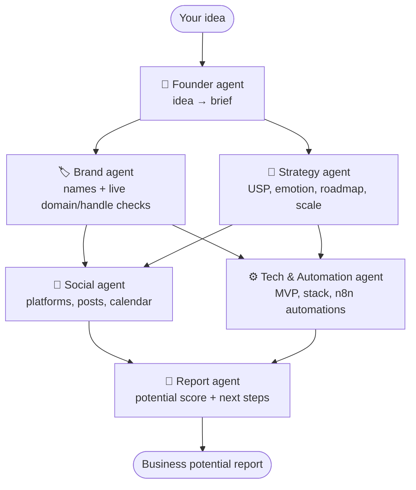

# 🔥 Foundry

**Discover your business potential with an open-source team of AI agents.**

Share a business idea. Foundry's agents name it, check if the domain and social handles are free, find your unique selling point and emotional hook, build a launch roadmap and scale plan, design your social media strategy, and hand you ready-to-import automations, all in about a minute.

Built for **Hacktoberfest 2026** · Agents orchestrated with **[DNotifier](https://www.dnotifier.com)** workflows · MIT licensed

---

## ✨ What you get

| | |
|---|---|
| 🏷️ **Brand names** | 8 brandable names, each **checked live** for `.com` `.co` `.io` `.ai` domains and GitHub, YouTube and Bluesky handles |
| 🎯 **Unique selling point** | Your one-line edge, the competitors you beat, and the gap you fill |
| ❤️ **Emotional core** | The feeling customers really buy, your brand story, and your tone of voice |
| 🗺️ **Roadmap** | Four phases from validation to first customers to growth |
| 📈 **Scale plan** | How the business grows beyond you, plus the risks to watch |
| 📣 **Social media strategy** | Platforms, content pillars, ready-to-paste bios, 5 first posts, a 14-day calendar and viral ideas |
| ⚙️ **Automation blueprint** | 5 workflows for your business, each **downloadable as an n8n workflow** |
| 🧮 **Potential score** | An honest 0–100 score with strengths, watch-outs and what to do this week |
| 📥 **Exports** | Markdown report, `.ics` content calendar (Google, Apple or Outlook), raw JSON |

## 🤖 How it works

Foundry is a team of six agents running as one **DNotifier workflow**. Agents in the same stage run in parallel (`ctx.runAgents`) and share their findings through workflow state, so the Social agent writes posts using the name the Brand agent picked and the USP the Strategy agent found.



Every AI call goes through **DNotifier AI** (`ctx.sendAI`), and each run is traced in the DNotifier workflow dashboard. The report shows the trace ID, for example `exec_4f5990e9add6`.

See **[docs/ARCHITECTURE.md](docs/ARCHITECTURE.md)** for the full system design.

## 🚀 Quick start

**You need:** Node.js 18+ and (for AI-written reports) a [DNotifier](https://www.dnotifier.com) app.

```bash
git clone https://github.com/hellohammadi/foundry.git
cd foundry
npm install
cp .env.example .env.local   # then add your DNotifier credentials
npm run dev
```

Open <http://localhost:3000>.

> **No credentials? It still works.** Without DNotifier credentials Foundry runs in **demo mode**: the domain and handle checks are still real, and the rest of the report uses templates. Judges and contributors can try it in seconds.

### Get DNotifier credentials

1. Sign in at [dnotifier.com](https://www.dnotifier.com) with Google.
2. Open **Apps** and create an app.
3. Copy the **App ID** and **App Secret** into `.env.local`:

```bash
DNOTIFIER_APP_ID=app_xxxxxxxx
DNOTIFIER_SECRET=xxxxxxxx
```

### Choosing the model (Gemma 4 and others)

DNotifier routes AI calls to the provider you choose. Set it in `.env.local`:

| Setting | Default | Example for Gemma 4 |
|---|---|---|
| `DNOTIFIER_AI_PROVIDER` | `open_ai` | `google_gemini` or `ollama` |
| `DNOTIFIER_AI_MODEL` | `gpt-4o-mini` | your Gemma 4 model ID |

The default `open_ai` provider is included with DNotifier plans. To use **Gemma 4**, first connect the provider in the DNotifier portal under **AI Studio → Providers**: a Google AI Studio key for `google_gemini`, or your Ollama URL for `ollama`. Then change the two settings above. No code changes are needed.

## 🔍 How the availability checks work

| Check | Method | Reliability |
|---|---|---|
| `.com`, `.net` | Official Verisign **RDAP** registry lookup | ✅ Authoritative |
| `.co`, `.io`, `.ai` | **DNS** nameserver lookup | 🟡 Very good; a registered domain with no DNS can look free |
| GitHub | GitHub public API | ✅ Verified |
| YouTube | `@handle` page status | ✅ Verified |
| Bluesky | AT Protocol handle resolution | ✅ Verified |
| Instagram, TikTok, X | These platforms block automated lookups | 🔗 Shown as a "check" link |

Foundry never claims a check it didn't actually do.

## 🗂️ Project structure

```
src/
├── app/
│   ├── page.tsx              # Landing page, idea form, live agent progress
│   └── api/analyze/route.ts  # Streams agent events (NDJSON) and the final report
├── components/
│   ├── AgentProgress.tsx     # Live status of each agent
│   └── ReportView.tsx        # The business potential report
└── lib/
    ├── llm.ts                # DNotifier client, AI calls, JSON parsing
    ├── exports.ts            # Markdown, .ics calendar and n8n workflow exports
    ├── types.ts              # Shared types
    ├── checks/
    │   ├── domains.ts        # RDAP + DNS domain checks
    │   └── handles.ts        # Social handle checks (add platforms here!)
    └── agents/
        ├── pipeline.ts       # DNotifier workflow: stages, runAgents, fallbacks
        ├── founder.ts  brand.ts  strategy.ts
        └── social.ts   tech.ts   report.ts
```

## 🤝 Contributing

Contributions are welcome, and many are beginner-friendly. Good first issues include:

- Add a social platform to the handle checker (Threads, Pinterest, Etsy…)
- Add a domain extension (`.in`, `.store`, `.shop`…)
- Add a new agent (Legal, Finance, Pitch Deck)
- Add country-specific business registration guidance
- Translate the UI

Read **[CONTRIBUTING.md](CONTRIBUTING.md)** to get started.

## 🛠️ Tech stack

- [Next.js 15](https://nextjs.org) (App Router) + TypeScript + Tailwind CSS 4
- [DNotifier](https://www.dnotifier.com) for agent workflows, AI and observability
- Public RDAP, DNS and platform endpoints for availability checks

## ⚖️ License

Foundry's code is released under the [MIT License](LICENSE).

Foundry depends on the DNotifier SDK (`@dnotifier-realtime/dnotifier`), which is distributed by DNotifier under its own proprietary license and is installed from npm, not included in this repository.

---

<p align="center">Made with ☕ for Hacktoberfest 2026</p>
