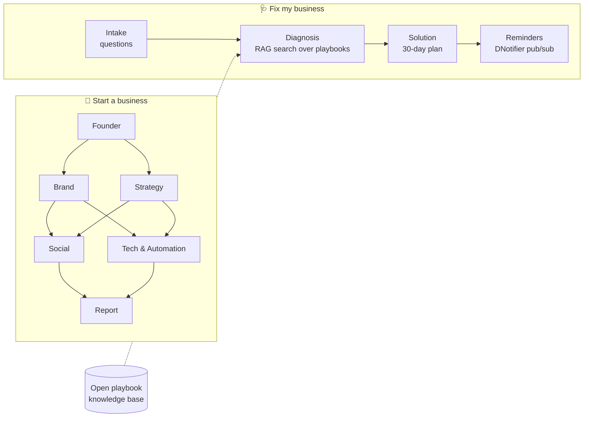

# 🔥 Foundry

**Discover your business potential with an open-source team of AI agents.**

Foundry helps founders at both ends of the journey:

- **🚀 Start a business:** share an idea. Agents name it, check whether the domain and social handles are free, find your unique selling point and emotional hook, and plan your launch, social media and automations.
- **🩺 Fix my business:** describe what's going wrong. An Intake agent asks the right questions, a Diagnosis agent finds the **root cause** (not just the symptom) by searching an open knowledge base of startup playbooks, and a Solution agent builds a prioritised **30-day plan** with weekly reminders.

Built for **Hacktoberfest 2026** · Powered end to end by **[DNotifier](https://www.dnotifier.com)** · MIT licensed

---

## 🧩 How Foundry uses DNotifier

| DNotifier feature | Where Foundry uses it |
|---|---|
| **Multi-agent workflows** (`Workflow`, `defineAgent`, `runAgents`) | Both agent teams run as DNotifier workflows with parallel stages and shared state |
| **AI pipeline** (`sendAI`) | Every AI call from every agent |
| **Knowledge base + RAG** (`addDocument`, `search`) | Open startup playbooks, searched semantically by the Diagnosis agent |
| **AI history** (`saveHistory`, `fetchAIHistory`) | Intake conversations are saved per user |
| **Real-time messaging / pub-sub** (`send`, `fetchChatHistory`) | Weekly plan reminders and report history, published to each user's channel |
| **Observability + logs dashboard** (`observability: true`, `logs: true`) | Every run has a trace ID (shown in the report) and AI token usage is logged |

## ✨ What you get

### 🚀 Start a business
| | |
|---|---|
| 🏷️ **Brand names** | 8 names, each **checked live** for `.com` `.co` `.io` `.ai` and GitHub, YouTube and Bluesky handles |
| 🎯 **Unique selling point** | Your edge, the competitors you beat, and the gap you fill |
| ❤️ **Emotional core** | The feeling customers buy, your brand story and tone of voice |
| 🗺️ **Roadmap + scale plan** | From validation to growth, and the risks to watch |
| 📣 **Social media strategy** | Platforms, pillars, bios, first posts, a 14-day calendar and viral ideas |
| ⚙️ **Automation blueprint** | 5 workflows, each **downloadable as an n8n workflow** |
| 🧮 **Potential score** | An honest 0–100 score with next steps |

### 🩺 Fix my business
| | |
|---|---|
| 💬 **Chat intake** | 5–7 questions written for your specific problem |
| 🔍 **Root-cause diagnosis** | Symptoms vs root cause, confidence level, and evidence from the playbooks |
| 📅 **30-day plan** | Quick wins for the next 48 hours, then 4 weeks of prioritised tasks and the metrics to track |
| 🔔 **Weekly reminders** | One reminder per week of the plan, delivered through DNotifier messaging |
| 🗂️ **History** | Past reports and reminders, stored per browser through DNotifier |

## 🤖 How it works



See **[docs/ARCHITECTURE.md](docs/ARCHITECTURE.md)** for the full design.

## 🎬 Demo script (3 minutes)

1. **Fix my business** → type *"We have lots of sales but no profit"*.
2. Answer a couple of the Intake agent's questions (for example "online bakery, free delivery on every order, 20% discount codes") and skip the rest.
3. Watch the Diagnosis agent search the knowledge base and name the root cause: prices below the true cost per order.
4. Show the 30-day plan and click **Send me weekly reminders**. They appear in *Your history & reminders*.
5. Open the **DNotifier dashboard** with the trace ID from the bottom of the report to show every agent step and token usage.
6. Bonus: switch to **Start a business** and run the chai subscription example to show live domain and handle checks.

## 🚀 Quick start

**You need:** Node.js 18+ and (for AI) a [DNotifier](https://www.dnotifier.com) app.

```bash
git clone https://github.com/hellohammadi/foundry.git
cd foundry
npm install
cp .env.example .env.local   # then add your DNotifier credentials
npm run dev
```

Open <http://localhost:3000>.

> **No credentials? It still works.** Without DNotifier credentials Foundry runs in **demo mode**. Domain and handle checks are real, playbook matching uses keyword search, and reports come from templates. History and reminders need DNotifier.

### Get DNotifier credentials

1. Sign in at [dnotifier.com](https://www.dnotifier.com) with Google.
2. Open **Apps** and create an app.
3. Copy the **App ID** and **App Secret** into `.env.local`:

```bash
DNOTIFIER_APP_ID=app_xxxxxxxx
DNOTIFIER_SECRET=xxxxxxxx
```

The playbooks load into your DNotifier knowledge base automatically on the first diagnosis.

### Choosing the model (Gemma 4 and others)

| Setting | Default | Example for Gemma 4 |
|---|---|---|
| `DNOTIFIER_AI_PROVIDER` | `open_ai` | `google_gemini` or `ollama` |
| `DNOTIFIER_AI_MODEL` | `gpt-4o-mini` | your Gemma 4 model ID |

The default `open_ai` provider is included with DNotifier plans. To use **Gemma 4**, connect the provider in the DNotifier portal under **AI Studio → Providers** (a Google AI Studio key for `google_gemini`, or your Ollama URL for `ollama`), then change the two settings above. No code changes are needed.

## 📚 The open playbook knowledge base

[`knowledge/`](knowledge/) holds plain Markdown playbooks: *sales but no profit*, *cash flow crunch*, *high churn*, *expensive customer acquisition*, *founder burnout*, *first hire*, *no product-market fit* and more. Each lists symptoms, root causes, how to confirm, fixes, a 30-day starter plan and metrics.

**Anyone can add one**, and every new playbook makes every diagnosis smarter. See [knowledge/README.md](knowledge/README.md).

## 🔍 How the availability checks work

| Check | Method | Reliability |
|---|---|---|
| `.com`, `.net` | Official Verisign **RDAP** registry lookup | ✅ Authoritative |
| `.co`, `.io`, `.ai` | **DNS** nameserver lookup | 🟡 Very good; a registered domain with no DNS can look free |
| GitHub, YouTube, Bluesky | Public profile or handle lookups | ✅ Verified |
| Instagram, TikTok, X | These platforms block automated lookups | 🔗 Shown as a "check" link |

## 🗂️ Project structure

```
knowledge/                    # Open startup playbooks (Markdown)
src/
├── app/
│   ├── page.tsx              # Mode switch, history & reminders
│   └── api/
│       ├── analyze/          # Start a business: streams the idea workflow
│       ├── intake/           # Fix my business: Intake agent questions
│       ├── diagnose/         # Fix my business: diagnosis workflow
│       ├── reminders/        # Publishes weekly reminders (DNotifier messaging)
│       └── inbox/            # Reads history + reminders (DNotifier chat history)
├── components/               # IdeaMode, DiagnoseMode (chat), reports, Inbox
└── lib/
    ├── llm.ts                # DNotifier client + AI helpers
    ├── knowledge.ts          # Playbook loading, seeding, search
    ├── inbox.ts              # DNotifier messaging for history and reminders
    ├── exports.ts            # Markdown, .ics and n8n exports
    ├── checks/               # Domain and handle checks
    └── agents/
        ├── team.ts           # Runs any agent team as a DNotifier workflow
        ├── pipeline.ts       # Start-a-business team
        ├── diagnose.ts       # Fix-my-business team
        └── *.ts              # One file per agent
```

## 🤝 Contributing

Good first issues:

- **Write a playbook** for a startup problem you know well (no coding needed!)
- Add a social platform to the handle checker
- Add a domain extension
- Add a new agent (Legal, Finance, Pitch Deck)
- Translate the UI

Read **[CONTRIBUTING.md](CONTRIBUTING.md)** to get started.

## 🛠️ Tech stack

- [Next.js 15](https://nextjs.org) (App Router) + TypeScript + Tailwind CSS 4
- [DNotifier](https://www.dnotifier.com): workflows, AI, RAG, messaging, observability
- Public RDAP, DNS and platform endpoints for availability checks

## ⚖️ License

Foundry's code and playbooks are released under the [MIT License](LICENSE).

Foundry depends on the DNotifier SDK (`@dnotifier-realtime/dnotifier`), which is distributed by DNotifier under its own proprietary license and is installed from npm, not included in this repository.

---

<p align="center">Made with ☕ for Hacktoberfest 2026</p>
