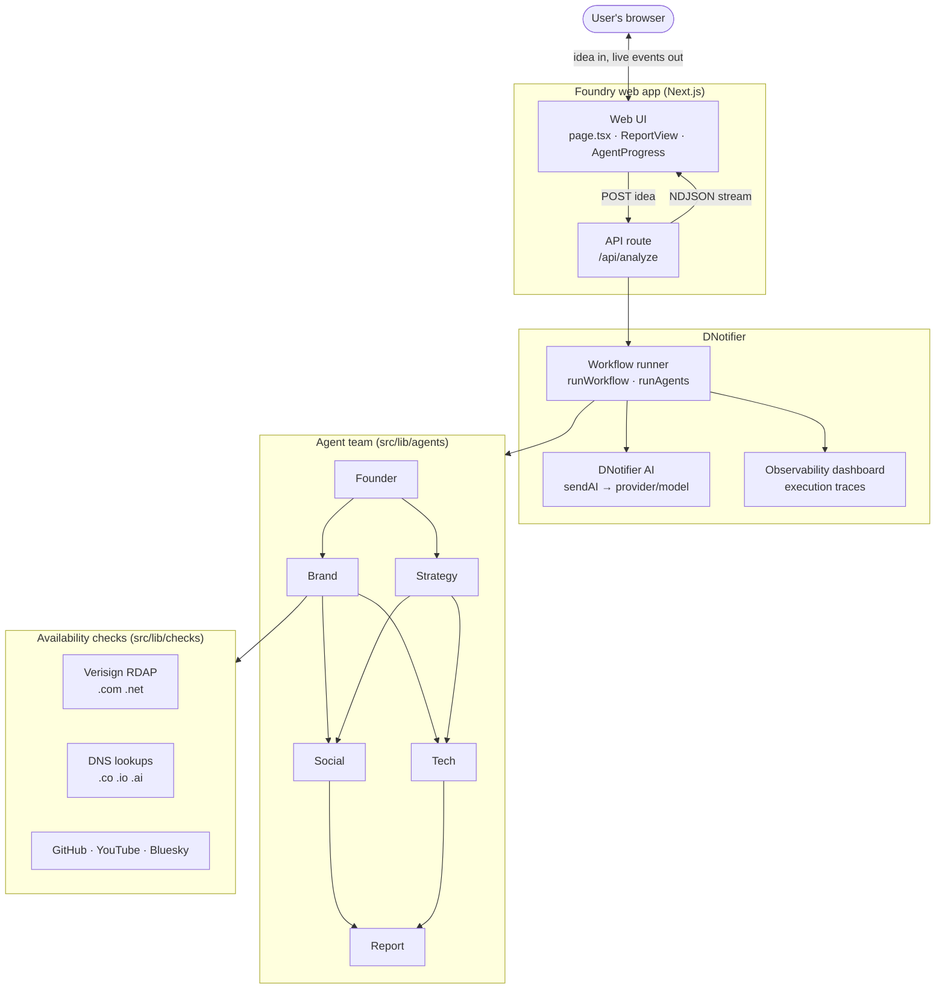
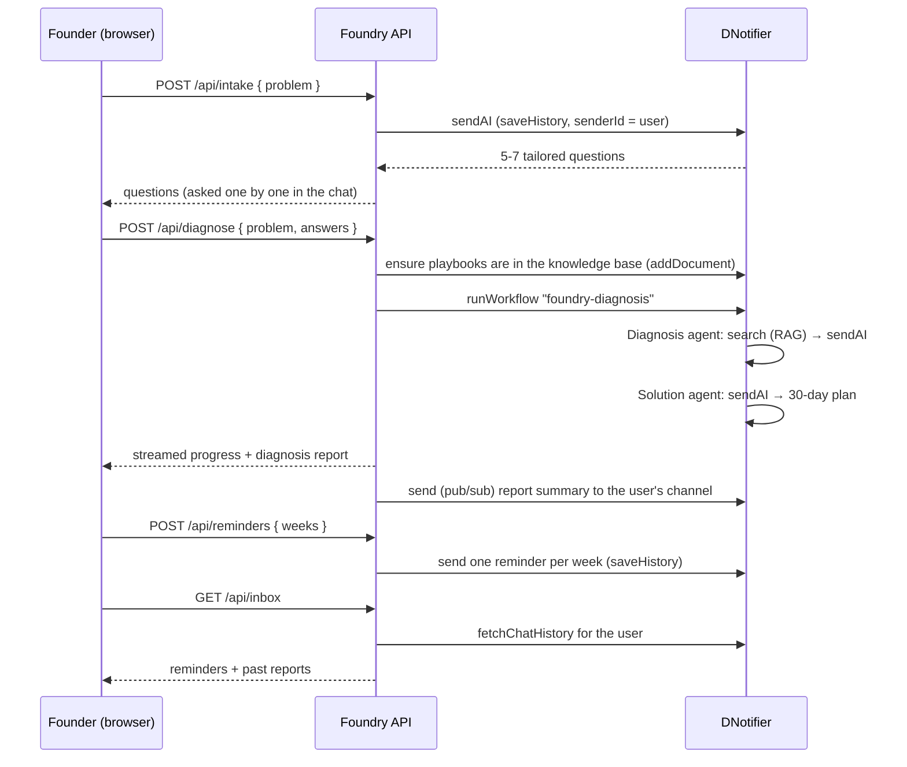

# Foundry architecture

This document explains how Foundry works end to end: from the moment someone types a business idea to the finished report.

## 1. System overview



## 2. Request lifecycle

1. **The user submits an idea** (plus optional audience, location and budget) from `src/app/page.tsx`.
2. **`POST /api/analyze`** validates the input and opens a streaming response (`application/x-ndjson`).
3. **`runFoundry()`** (`src/lib/agents/pipeline.ts`, using the shared team runner in `src/lib/agents/team.ts`) gets the shared DNotifier client (`getNotifier()` in `src/lib/llm.ts`). It connects once per server instance and checks `aiEnabled`.
4. **A DNotifier `Workflow` is built** for this request. Each Foundry agent is wrapped with `DNotifier.defineAgent`, and the workflow's `entry` runs four stages with `ctx.runAgents([...])`.
5. **Each agent** builds its prompt from the idea plus earlier agents' results (`ideaContext()`), calls DNotifier AI through `ctx.sendAI`, and parses the JSON reply.
6. **Events stream to the browser** as each agent starts, logs progress and finishes, so the UI shows the team working live.
7. **The final report** is sent as the last event. It includes the DNotifier `executionId` so the run can be inspected in the DNotifier dashboard.

### Stream events

```ts
{ type: "agent",  agent: "brand", status: "running" | "done" | "error" }
{ type: "log",    agent: "brand", message: "Checking domains and handles for 8 names" }
{ type: "report", report: Report }
{ type: "error",  message: string }
```

## 3. The agent team

| Stage | Agent | Reads | Writes (`state.*`) | Notes |
|---|---|---|---|---|
| 1 | **Founder** | idea | `brief` | Summary, audience, problem, business model |
| 2 | **Brand** | brief | `brand` | Model invents 8 names; Foundry checks every name live and ranks by availability |
| 2 | **Strategy** | brief | `strategy` | USP, competitors, emotional core, story, roadmap, scale plan, risks |
| 3 | **Social** | brief, brand, strategy | `social` | Platforms, pillars, bios, posts, 14-day calendar, viral ideas |
| 3 | **Tech & Automation** | brief, brand, strategy | `tech` | MVP, stack with costs, 5 automations, launch checklist |
| 4 | **Report** | everything | `potential` | 0–100 score, verdict, strengths, watch-outs, next steps |

Agents in the same stage run **in parallel**. Stages run in order, so later agents build on earlier ones.

### Agent interface

Every agent is a small object (`src/lib/agents/types.ts`):

```ts
type Agent = {
  id: AgentId;              // "brand"
  name: string;             // "Brand"
  role: string;             // shown in the UI
  output: keyof AgentState; // which part of shared state it fills
  run: (ctx: AgentContext) => Promise<void>;
};
```

`ctx.ask(system, user)` sends a prompt through DNotifier AI. `ctx.live` is `false` in demo mode, where each agent produces a template answer instead.

## 3b. "Fix my business" mode



| Agent | File | What it does |
|---|---|---|
| **Intake** | `src/lib/agents/intake.ts` | Writes 5–7 questions for the founder's problem. Runs as a saved DNotifier AI conversation for the user. Falls back to core questions. |
| **Diagnosis** | `src/lib/agents/diagnosis.ts` | Semantic search over the playbooks (`ctx.search`), then separates symptoms from the root cause using the founder's answers and the retrieved playbooks |
| **Solution** | `src/lib/agents/solution.ts` | Turns the diagnosis and the playbook fixes into quick wins, a 4-week plan and metrics |

The knowledge base lives in [`knowledge/`](../knowledge/) as Markdown. `ensureKnowledgeBase()` (`src/lib/knowledge.ts`) adds any missing playbook to DNotifier the first time a diagnosis runs. Each document starts with `Playbook: <slug>`, so search hits map back to their file. In demo mode, `localSearch()` uses keyword overlap instead.

## 3c. History and reminders (DNotifier messaging)

Each browser gets a random anonymous id (`fd-…`, stored in `localStorage`). This id is the user's DNotifier channel.

- **Publishing:** the server keeps one WebSocket connection as `foundry-server` and `send`s items to the user's channel with `saveHistory: true`. Items are report summaries (after each run) and weekly reminders (on request).
- **Reading:** `/api/inbox` connects as the user, calls `fetchChatHistory`, and returns **only the parsed Foundry items**. Raw history entries contain auth metadata, so they never reach the browser.
- **Credentials** stay on the server. The browser only ever talks to Foundry's API.

Reminders are stored with a due date (week 1 = today, week 2 = +7 days…). The inbox highlights reminders that are due. Delivering them by email or push at the due time is a natural next step (see the roadmap issues).

## 4. Reliability

AI output isn't always perfect, so Foundry has three safety nets:

1. **JSON extraction and retry.** `askJson()` pulls JSON out of prose or code fences. If parsing fails, it retries once with a stricter instruction.
2. **Gap filling.** After a live run, any missing or wrongly typed top-level field is filled from the agent's template (`fillGaps()`), so the UI never breaks.
3. **Per-agent fallback.** If an agent's AI call fails completely, that agent falls back to its template and the rest of the report still uses AI.

**Demo mode.** If DNotifier credentials are missing or AI isn't enabled, the whole pipeline runs locally from templates. The domain and handle checks are still real.

## 5. Availability checks

| File | What it does |
|---|---|
| `src/lib/checks/domains.ts` | `.com`/`.net` via Verisign RDAP (404 = available). Other TLDs via DNS nameserver lookup (`ENOTFOUND` = likely available). |
| `src/lib/checks/handles.ts` | A `PLATFORMS` list. Each platform has a profile URL and, if lookups are possible, a `check()` function. Platforms that block lookups are shown as manual-check links. |

Each name gets an **availability score** (0–100): `.com` free = 40, each other free domain = 10, and free verified handles share the remaining 30.

## 6. Exports (`src/lib/exports.ts`)

All exports are generated **in the browser**, so nothing extra is sent to a server.

- **Markdown report**: the full report, ready for Notion, GitHub or Google Docs.
- **`.ics` calendar**: the 14-day content plan as all-day events starting tomorrow.
- **n8n workflows**: each automation becomes an importable n8n workflow, with a webhook or schedule trigger plus one documented placeholder node per step.

## 7. Configuration

| Variable | Required | Default | Purpose |
|---|---|---|---|
| `DNOTIFIER_APP_ID` | For AI | — | DNotifier app ID |
| `DNOTIFIER_SECRET` | For AI | — | DNotifier app secret (server-only, never sent to the browser) |
| `DNOTIFIER_AI_PROVIDER` | No | `open_ai` | DNotifier provider: `open_ai`, `google_gemini`, `ollama`, `anthropic`… |
| `DNOTIFIER_AI_MODEL` | No | `gpt-4o-mini` | Model ID for that provider, for example a Gemma 4 model |

## 8. Security notes

- The DNotifier secret is only read on the server (`src/lib/llm.ts`). It is never included in the browser bundle.
- `.env*` files are git-ignored. Never commit real credentials.
- User input is trimmed and length-limited before it reaches any prompt.
